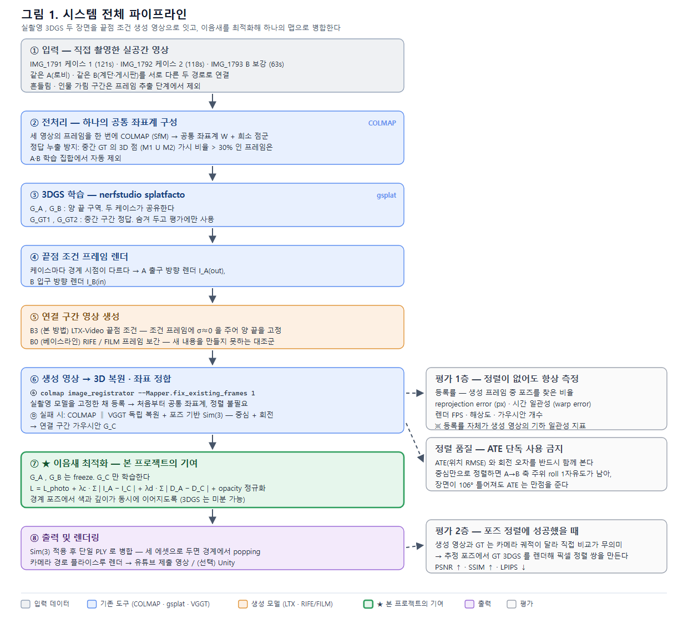

# 끝점 조건 영상 생성을 이용한 실사 3DGS 조각 맵 브리징

메타버스컴퓨팅 기말고사 대체 프로젝트 · 2026-2학기
작성 시작 2026-11-19 · 제출 2026-12-04

> 📌 작성 규칙: 실험이 끝날 때마다 해당 절만 채운다. `[TODO]`는 아직 측정 안 된 값.
> 교수님 루브릭 5단: **관찰 → 한계 → 문제 정의 → 내 방식 → 기여**. 각 절 제목 옆에 어느 단인지 표시.

---

## 1. 서론  〔관찰 · 한계 · 문제 정의〕

### 1.1 배경 — 관찰

실제 장소를 촬영해 3D 공간으로 복원하는 기술이 실용 단계에 들어왔다. NeRF 계열에 이어 3D Gaussian Splatting(3DGS)은 명시적 프리미티브와 타일 기반 래스터화로 실시간 렌더링이 가능해졌고, 게임 엔진으로 가져와 쓰는 경로도 열려 있다. 그 결과 "실제 장소를 찍어 맵으로 만든다"는 작업이 개인 수준에서도 가능해졌다.

### 1.2 한계

그런데 이렇게 만든 맵은 **조각(fragment)** 이다. 촬영은 특정 장소 단위로 이루어지므로, 서로 다른 두 장소 A와 B를 각각 복원해도 **그 사이를 이어 줄 공간이 존재하지 않는다.** 두 조각을 한 공간에 배치하면 경계에서 끊긴다.

사이 공간을 생성 모델로 만들어 채우는 접근을 생각할 수 있다. 그러나 현재의 주류 생성 방식은 이 문제에 바로 쓰이지 않는다.

- **World model / 자기회귀 생성** (DIAMOND, IRIS, DreamerV3 등)은 과거 프레임과 행동을 조건으로 **다음 프레임을 앞으로만** 생성한다. 목표 지점을 조건으로 줄 수 없으므로 "B에 도착하도록" 생성하는 것이 구조적으로 불가능하다.
- **장면 확장 계열** (WonderJourney, WonderWorld)은 한 시작점에서 바깥으로 넓혀 나가는 방식이며, 주어진 **두 끝점 사이를 메우는** 문제를 다루지 않는다.
- **끝점 조건 영상 생성** (Wan 2.1 FLF2V, LTX)은 처음·끝 프레임을 모두 조건으로 받지만 **출력이 2D 영상까지**다. 3D로 복원해 기존 맵에 이어 붙이는 단계가 없다.

### 1.3 문제 정의

본 프로젝트가 푸는 문제는 다음과 같다.

> **실사 촬영으로 만든 두 개의 3DGS 장면 A, B가 주어졌을 때, 그 사이를 자연스럽게 잇는 3DGS 구간을 생성하고 하나의 장면으로 통합할 수 있는가. 그리고 그 결과를 어떻게 정량적으로 평가할 수 있는가.**

두 번째 질문이 특히 중요하다. 생성된 공간은 비교할 정답이 없는 것이 보통이라 평가가 주관적 비교에 머무른다. 본 프로젝트는 **A→B를 끊지 않고 한 번에 촬영한 뒤 중간 구간을 숨겨 정답(GT)으로 사용**함으로써 이 문제를 회피한다.

### 1.4 기여

1. 끝점 조건 영상 생성 → 3D 복원 → 좌표 정렬 → 이음새 최적화로 이어지는 **3DGS 브리징 파이프라인**
2. **끝점 조건 생성이 '보간' 으로 무너지는 조건과 그렇지 않은 조건의 분리.**
   같은 모델·같은 프롬프트라도 한 클립이 덮어야 할 거리가 길면 중간을 만들지 않고 두 끝을 보간하며,
   짧게 끊으면 전진한다. 이 경계를 측정으로 보인다(§3.3, §4.3).
   덧붙여 LTX-Video 의 **마지막 프레임 조건이 실제로 동작함을 수치로 확인**했다 —
   문서에 예제가 없어 불확실했던 부분이다(첫 34.46 dB / 끝 30.00 dB, 교차 13 dB대).
3. **생성 영상이 SfM 으로 재구성 가능함을 확인**(등록률 43~65%, 재투영 오차 약 1 px).
   생성적 전이 연구가 2D 에서 멈추는 지점과 3DGS 통합 사이에 **실제로 다리가 있음**을 보인 것이다.
4. 경계 일관성 손실을 추가한 **이음새 최적화**와 그 전후 정량 비교
5. **평가 지표의 함정 문서화.** 끝점 거리 PSNR 은 '새 공간 생성' 과 '구조 붕괴' 를 구분하지 못하고
   (11.46 vs 12.27), 궤적 직진성은 '얼마나 멀리' 가 아니라 '얼마나 곧게' 를 잰다. 어떤 지표가
   무엇을 **못 재는지**를 함께 보고한다(§4). 같은 문제를 다루는 후속 연구에 바로 쓰이는 결과다.

> 📌 2·3·5 는 처음부터 목표한 것이 아니라 **탐색 과정에서 드러난 것**이다. §3.3 에 그 순서를
> 그대로 적었다 — 어떤 방법이 왜 부족했고 그래서 무엇을 썼는지가 이 연구의 실질적 내용이다.

---

## 2. 관련 연구  〔한계〕

| 연구 | 하는 일 | 본 연구와의 차이 |
|---|---|---|
| DIAMOND (NeurIPS 2024) | EDM diffusion 기반 world model, 픽셀 공간 직접 생성 | 앞으로만 생성, 끝점 조건 불가. 실사 장면 아님 |
| IRIS (ICLR 2023) | 이산 토큰 + Transformer world model | 동일. 토큰화로 시각 디테일 손실 |
| WonderJourney (2023) | LLM + 포인트클라우드로 장면 연속 생성 | 시작점에서 바깥으로 확장, 끝점 없음 |
| WonderWorld (2024) | 단일 이미지에서 연결된 3D 장면 생성 | 실사 맵 두 개를 잇는 문제가 아님 |
| Generative Gaussian Splatting (ICCV 2025) | 비디오 diffusion prior + 3DGS 장면 생성 | 입력 이미지로부터의 생성, 브리징 아님 |
| GaussVideoDreamer (2025) | 단일 이미지 → 비디오 diffusion → 3DGS | 단일 입력, 브리징 아님 |
| Wan 2.1 FLF2V / LTX-Video | 처음·끝 프레임 조건 영상 생성 | 2D 영상까지. 3D 복원·통합 없음 (본 연구가 기반으로 사용) |
| FILM / RIFE | 대변위 프레임 보간 | 새로운 내용을 생성하지 못함 (본 연구의 베이스라인) |

### 2.1 생성적 장면 전이 (2D)

| 연구 | 하는 일 | 본 연구와의 차이 |
|---|---|---|
| **SEINE** (ICLR 2024) | **"generative transition"** — 서로 다른 두 장면을 잇는 전이 영상 생성 | **출력이 2D 영상까지.** 3D 복원·기존 맵 통합 없음 |
| **UniScene-MoTion** (AAAI) | 깊이 인식 3D 추론을 넣은 scale-aware 영상 전이 | 3D를 추론에 쓰지만 산출물이 영상. 실사 3DGS 맵에 이어 붙이지 않음 `⚠️ 가장 가까운 선행연구 — 정독 필요` |
| arXiv 2511.17932 (2025) | 사전학습 영상 diffusion prior로 **중간 시점(in-between views)** 을 환각, 3DGS 사용 | **하나의 장면 내 희소 시점 보간.** 서로 다른 두 장면 사이의 빈 공간이 아님 |
| SpatialCrafter / VideoScene | 영상 diffusion을 희소 시점 3D 복원의 prior로 사용 | 복원 보조. 장면 사이 브리징 아님 |

### 2.2 3DGS 정합·병합 — 이음새 파트의 직접 선행연구

| 연구 | 하는 일 | 본 연구와의 차이 |
|---|---|---|
| **GaussReg** | 가우시안 프리미티브에서 정합, 렌더링 기반 네트워크로 정렬 보정 | **겹침이 있는 두 장면을 정렬.** 생성 없음 |
| **PhotoReg** | 장면을 단순 결합 | 경계에 **가시적 아티팩트**가 남음 |
| **Graph-GSReg** | 3D 장면 그래프 기반 정합 + test-time 최적화로 병합 결과 평탄화 | 동일. 다만 *"두 3DGS 장면을 단순 병합하면 hollow·floater 같은 아티팩트가 생긴다"* 는 문제 인식은 본 연구의 이음새 최적화와 같음 |
| Skeleton Alignment 기반 정합·융합 (IROS 2025, arXiv 2507.20480) | 서브맵 자동 정합 + 다요인 융합 (ScanNet-GSReg 벤치마크) | 동일. **서브맵 간 겹침 전제** |

### 2.3 신규성 위치

위 두 계열은 각각 한쪽만 다룬다.

- **생성적 전이 계열**(SEINE, UniScene-MoTion)은 **2D 영상까지만** 만든다. 3D로 복원해 기존 맵에 통합하지 않는다.
- **3DGS 정합·병합 계열**(GaussReg, PhotoReg, Graph-GSReg, 2507.20480)은 **두 장면이 겹쳐 있다고 가정**한다. 겹침 영역의 대응을 찾아 정렬하는 문제다.

🔑 **본 연구의 설정은 두 장면이 겹치지 않고 그 사이가 비어 있다.** 겹침이 없으므로 정합만으로는 풀 수 없고, 빈 공간을 **생성**해 넣어야 한다. 즉 "생성적 전이"와 "3DGS 병합"을 잇는 자리가 본 연구의 위치다.

추가로, 생성된 공간은 비교할 정답이 없어 평가가 주관적 비교에 머무르는 것이 보통이다. 본 연구는 **A→B 연속 촬영 후 중간 구간을 숨겨 GT로 사용**하고 **추정 포즈에서 GT 3DGS를 렌더링해 비교**하는 평가 프로토콜을 제시한다. 조사 범위에서 동일한 평가 설계는 확인되지 않았다.

> ⚠️ **작성 시 확인할 것**: 위 표의 내용은 초록·요약 수준에서 정리한 것이다. 특히 **UniScene-MoTion**과 **SEINE**은 본문을 정독해 (a) 산출물이 영상인지 3D인지 (b) 두 장면이 겹치지 않는 설정을 다루는지 확인한 뒤 차이 서술을 확정해야 한다. ScanNet-GSReg 벤치마크는 정량 비교에 쓸 수 있는지 검토.

---

## 3. 방법론  〔내 방식〕

### 3.1 전체 파이프라인



**그림 1.** 시스템 전체 파이프라인 (벡터 원본: `그림/파이프라인.svg`, 생성 코드: `코드/파이프라인_그림.py`). 파란색은 기존 도구, 주황색은 생성 모델, **초록색 굵은 테두리가 본 프로젝트의 기여**이며, 오른쪽 점선은 각 단계에서 평가 지표를 뽑는 지점이다.

전체 흐름은 입력부터 최종 렌더링까지 여덟 단계다.

**① 입력.** 학과 건물 실내를 직접 촬영한 세 개의 영상을 쓴다. IMG_1791(케이스 1)과 IMG_1792(케이스 2)는 **같은 로비 A에서 출발해 같은 계단·게시판 구역 B에서 끝나되 서로 다른 경로**를 지나고, IMG_1793은 B 구역만 따로 찍은 보강 영상이다. 같은 끝점을 서로 다른 두 경로로 잇기 때문에, 브리징이 해가 하나로 정해지는 문제가 아니라는 점을 한 실험 안에서 보일 수 있다. 흔들림과 인물 가림이 있는 구간은 프레임 추출 단계에서 제외한다.

**② 전처리 — 공통 좌표계.** 세 영상의 프레임을 **한 번에** COLMAP 에 넣어 단일 좌표계 $W$ 와 희소 점군을 얻는다. A·B 구역이 세 영상에 공통으로 등장하므로 자동으로 하나의 모델로 연결된다. 이 단계가 평가 설계의 핵심이다 — A, B, 중간 GT 가 처음부터 같은 좌표계에 있으므로 뒤에서 생성 결과를 GT 와 직접 비교할 수 있다.

중간 구간은 **정답**이므로 A·B 의 3DGS 학습에 새어 들어가면 안 된다. 시간 구간을 손으로 자르는 대신, 중간 GT 프레임들에서 삼각측량된 3D 점 집합 $M_1, M_2$ 를 기준으로 **A·B 후보 프레임에서 보이는 3D 점 중 $M_1 \cup M_2$ 에 속하는 비율이 임계값(30%)을 넘으면 제외**하는 규칙을 쓴다. 규칙으로 기술할 수 있어 재현이 가능하다.

**③ 3DGS 학습.** nerfstudio 의 splatfacto(gsplat 백엔드)로 $G_A$, $G_B$ 를 학습한다. 두 케이스가 A 와 B 를 공유하므로 이 둘은 한 번만 만들고 재사용한다. 중간 GT 는 케이스별로 $G_{GT1}$, $G_{GT2}$ 를 따로 학습해 숨겨 두고 평가에만 쓴다.

**④ 끝점 조건 프레임.** $G_A$ 에서 A 의 출구 방향을, $G_B$ 에서 B 의 입구 방향을 렌더해 조건 프레임으로 삼는다. **경계 시점은 케이스마다 다르다** — 같은 A 라도 케이스 1 은 자판기 쪽, 케이스 2 는 출입문 쪽으로 나가기 때문이다.

**⑤ 연결 구간 영상 생성.** 본 방법(B3)은 LTX-Video 의 끝점 조건 생성을 쓴다. LTX 는 별도 파라미터나 특수 토큰 없이 **조건 프레임의 잠재에 $\sigma \approx 0$ 에 가까운 노이즈 레벨만 주는 방식**이라, 같은 원리로 첫 프레임뿐 아니라 마지막 프레임에도 조건을 걸 수 있다. 베이스라인 B0 는 RIFE/FILM 프레임 보간으로, 두 프레임 사이를 워핑·블렌딩할 뿐 **새 내용을 만들지 못한다**는 점에서 생성 모델의 필요성을 보이는 대조군이다.

**⑥ 3D 복원과 좌표 정합.** 생성 영상을 3D 로 되돌려야 기존 맵에 붙일 수 있다. 두 경로를 둔다.

- **ⓐ 등록 (우선)** — ② 에서 만든 실촬영 모델을 고정한 채 생성 프레임을 거기에 등록한다 (`colmap image_registrator --Mapper.fix_existing_frames 1`). 성공하면 처음부터 공통 좌표계이므로 **정렬 단계 자체가 필요 없고**, 등록 성공률이 그대로 생성 영상의 기하 일관성 지표가 된다.
- **ⓑ 정렬 (폴백)** — ⓐ 가 실패하면 생성 영상만 따로 복원(COLMAP ‖ VGGT)한 뒤 Sim(3) 로 맞춘다. 이때 카메라 중심만 쓰면 퇴화한다 (§3.4).

결과로 연결 구간 가우시안 $G_C$ 를 얻는다.

**⑦ 이음새 최적화.** 본 프로젝트의 기여. §3.5 에서 기술한다.

**⑧ 출력.** Sim(3) 를 적용한 뒤 $G_A, G_C, G_B$ 를 **하나의 PLY 로 병합**한다. 세 개의 에셋으로 두면 에셋 간 깊이 정렬이 되지 않아 경계에서 popping 이 보이기 때문이다. 병합된 장면에서 카메라 경로를 따라 플라이스루를 렌더해 제출 영상으로 쓴다.

### 3.2 데이터 획득과 공통 좌표계
A→B 연속 촬영 1회. 전체 프레임에 대해 COLMAP을 한 번 수행하여 A 구간·중간 구간·B 구간이 **단일 좌표계**에 놓이도록 한다. 이로써 (a) 중간 구간이 GT로 쓰일 수 있고 (b) A·B 사이의 상대 자세가 이미 알려져 있다.
국민대학교 학과 건물 실내에서 A→B 경로를 연속 촬영했다(IMG_1791). 추가로 A 구역 재촬영(1792)과
B 구역 단독 촬영(1793)을 합쳐 **3개 영상 755프레임(2.5fps)** 을 COLMAP 으로 한 번에 재구성했고,
전부 단일 좌표계에 등록되었다(평균 track length 12.19).

장면 분할은 시간으로 자르지 않고 **누출 규칙**으로 했다. 숨길 중간 구간이 보는 3D 점 집합을 $M$ 이라 할 때
$\mathrm{leak}(f)=|\mathrm{pts}(f)\cap M|/|\mathrm{pts}(f)|$ 가 0.30 을 넘는 프레임은 끝점 장면 학습에서 제외한다.
이 규칙이 경계에서 정답이 들여다보이는 36장을 정확히 집어냈다 — 시간으로 잘랐다면 그대로 들어갔을 프레임들이다.

| 장면 | 출처 | 프레임 | 3D 점 |
|---|---|---|---|
| $G_A$ | 1791 @0–57s | 131 | 23,377 |
| $G_{GT}$ (숨김, 평가 전용) | 1791 @64–114s | 115 | 22,505 |
| $G_B$ | 1793 전체 | 143 | 23,165 |

영상 1792 는 A→B 를 **끊김 없이** 걸어가므로 끝점 장면 학습에서 완전히 제외했다. 포함하면
$G_A\cup G_B$ 가 이미 실촬영 연결로를 담게 되어 "끊긴 두 장면을 잇는다" 는 전제가 무너진다.
공통 좌표계를 세우는 데까지만 기여시켰다(track length 10.43 → 12.19).

⚠️ **간극과 정답의 범위가 다르다.** 다리를 놓을 구간은 1791 의 57s 이후 전체지만 $G_{GT}$ 는
64–114s 만 덮는다. 57.2–64.0s 는 누출 규칙으로 제외되어 어느 쪽에도 없다. 따라서 **정량 평가는
간극의 중앙부에 대해서만 가능하다.**

### 3.3 끝점 조건 영상 생성

> **이 절은 완성된 설계가 아니라 탐색의 기록이다.** 연결 구간을 만드는 방법을 처음부터 알고
> 시작하지 않았다. 매번 **직전 방법의 부족한 점이 드러나서 다음 방법을 쓴** 연쇄이고,
> 그 부족한 점들이 이 연구가 실제로 기여하는 지점이다. 순서대로 적는다.

| # | 방법 | 드러난 부족한 점 | 그래서 다음에 |
|---|---|---|---|
| 1 | 단일 클립 (A→B 한 번에) | 중간을 **만들지 않고 두 끝을 보간**한다. 50% 지점에 이미 B 가 보인다 | 구간을 쪼갠다 |
| 2 | 웨이포인트 분할 (오라클) | 블렌딩이 사라지고 새 공간이 생긴다. 그러나 **웨이포인트를 정답에서 가져왔다** | 정답 없이 웨이포인트를 얻는다 |
| 3 | 재귀 웨이포인트 (1차 생성물에서) | 가져온 프레임이 **이미 오염돼 있어 증폭**된다 | 오염되지 않은 기준을 준다 |
| 4 | 끝점 좌표를 가이드 영상으로 | API 가 조건을 **'참고' 가 아니라 '내용' 으로** 그린다. 가이드의 결함까지 재현한다 | 조건을 이미지 한 장으로 줄인다 |
| 5 | 짧은 보폭 연쇄 (6걸음×97f) | 전진한다. 그러나 **간극의 절반밖에 못 간다**. 색이 13% 밀리고 끝에서 열화된다 | 걸음을 늘리고 색을 되돌린다 |
| 6 | 12걸음 + 앵커 색보정 | 색은 잡히지만(−0.4%) **중간에 붕괴한 뒤 다른 건물로 리셋**된다. 등록률 59%→32% | 재입력 횟수를 줄인다 |
| 7 | 6걸음 × 긴 클립(161f) | **회전 드리프트로 천장을 본 채 정지.** 직진성 0.266 — 경로가 직선거리의 3.8배 | 매 걸음에 가까운 목표를 준다 |
| 8 | 깊이 워핑 목표 (예정) | — | — |

**5·6·7 을 관통하는 것**: 끝점 조건 없는 걸음은 결국 멈춘다. 걸음을 늘려도 클립을 늘려도
멈추는 시점만 달라진다. 그리고 멈춘 뒤 마지막에 B 를 걸면 거리를 한 번에 메우느라 착지가
망가진다(35.84 → 30.48 → 27.43 dB). **보간을 유발한 것은 끝점 조건 자체가 아니라 그 끝점이
너무 멀다는 것이었고, 가까운 끝점은 방향 지시로 작동한다.**

**부족한 점을 찾는 것 자체가 어려웠다.** §4 에서 다루듯 끝점 거리 기반 지표(PSNR)는 2·3 을
구분하지 못했고(11.46 vs 12.27), 궤적의 직진성은 '얼마나 멀리' 가 아니라 '얼마나 곧게' 를 쟀다.
**지표가 무엇을 못 재는지를 먼저 적는 것**이 이 탐색에서 가장 비싼 교훈이었다.

#### 3.3.1 설정

**끝점 조건 프레임.** 포즈를 손으로 만들지 않았다. 합본 COLMAP 이 세 영상을 같은 좌표계에 두었으므로
경계 프레임의 실제 촬영 포즈가 정의상 맞는 끝점이다. $G_A$ 에서 A 의 마지막 시점(`v1791_00143`)을,
$G_B$ 에서 B 의 첫 시점(`v1793_00001`)을 렌더해 $I_A^{out}, I_B^{in}$ (960×540)으로 썼다.
같은 포즈의 실촬영 프레임(1920×1080)도 함께 보관해 §4 에서 비교한다 — 원본이 더 선명하지만,
생성 구간이 이어붙어야 하는 대상은 사진이 아니라 $G_A, G_B$ 라는 **지도**이므로 렌더본으로 조건을 주면
⑦ 이음새 최적화의 부담이 줄어든다. 렌더본과 실촬영은 육안 구분이 어렵다(그림 `끝점_조건프레임_비교.png`).

**모델 선택.** **LTX-Video 0.9.5 (2B)** 를 쓴다. 더 큰 변형을 쓰지 못하는 이유는 품질이 아니라
**메모리 구조**다. LTX-2(19B)·LTX-Video 0.9.7(13B)의 끝점 조건 예제는 `enable_sequential_cpu_offload`
를 전제하는데, 이는 가중치를 시스템 RAM 에 상주시키고 레이어 단위로 GPU 에 올리는 방식이다.
bf16 19B ≈ 38GB 로 WSL 기본 상한(호스트 RAM 31.2GB 의 50% = 15.6GB)은 물론 호스트 전체로도 안 된다.
0.9.5 는 2B 라 16GB VRAM 안에서 오프로딩 없이 돈다. **0.9.5 부터 조건 이미지를 여러 장 받으므로
처음·끝 양쪽에 조건을 거는 데 필요한 기능은 갖춰져 있다.**

**생성 설정.** 1024×576, 161프레임(24fps, 6.7초), 40스텝. 해상도는 VAE 의 공간 압축 때문에 가로·세로가
32 의 배수여야 하는데 3DGS 렌더가 960×540 이고 540 이 32 의 배수가 아니다. 16:9 를 유지하면서 둘 다
32 의 배수인 값이 1024×576 이다. 프레임 수는 VAE 의 시간축 격자 때문에 $8k+1$ 이어야 한다.

⚠️ **클립 길이가 간극보다 짧다 — 다만 그 영향은 시차가 아니라 '묘사해야 할 거리' 다.**
합본 모델에서 잰 간극은 직선거리 **15.03**(COLMAP 단위), 두 끝점의 시선 방향 차이 **80.1°**,
실제 보행 경로 길이 17.78(직선 대비 1.18배로 거의 직선)이다. 메울 구간은 실촬영 기준 약 50초를
걷는 거리인데 LTX 가 한 번에 만드는 길이는 6.7초다.

여기서 **프레임 간 시차는 문제가 되지 않는다.** COLMAP 입력은 2.5fps 로 뽑아 프레임당 0.1433 씩
움직이는 반면, 생성물은 24fps 로 161프레임이므로 프레임당 0.0939 — **실촬영보다 오히려 촘촘하다.**
문제는 모델이 **6.7초 안에 15 단위를 전진해야 한다는 사실을 모른다**는 데 있다. 조건으로 주어지는
것은 사진 두 장과 텍스트뿐이므로, 그 제약이 없는 상태에서는 두 끝을 보간하는 쪽이 손실이 낮다. 완화책은 두 가지다 — (i) 지원하는 최대
프레임 수를 쓴다, (ii) 중간 웨이포인트를 두고 여러 클립으로 나눠 생성한 뒤 이어붙인다. (ii)는 각 클립의
끝점이 다시 조건이 되므로 본 방법의 구조를 그대로 재귀적으로 적용하는 형태다.

**1차 생성 결과.** 161프레임을 **212.1초**(1.32초/프레임, 4.8초/스텝)에 생성했고 VRAM 최대
**8.77 GB** 를 썼다. 텍스트 인코딩은 별도 프로세스에서 1회만 수행한다(288.5초) — 프롬프트가 생성 중
바뀌지 않으므로 인코딩 후 프로세스를 끝내면 T5-XXL 의 9GB 가 반환되고, 확산 단계는 약 5GB 로 돈다.
이 분리가 없으면 WSL 메모리 상한에서 VM 자체가 내려간다.

**끝점 조건이 실제로 걸렸는지의 검증.** LTX-Video 문서에는 마지막 프레임 조건 예제가 없다. 음수
인덱스 지원도 문서화되어 있지 않아 `frame_index = num_frames - 1` 로 명시해 넣고, 걸렸는지를 직접 쟀다.

| 비교 | PSNR |
|---|---|
| 생성 첫 프레임 vs $I_A^{out}$ | **34.46 dB** |
| 생성 끝 프레임 vs $I_B^{in}$ | **30.00 dB** |
| (대조) 첫 프레임 vs $I_B^{in}$ | 13.87 dB |
| (대조) 끝 프레임 vs $I_A^{out}$ | 13.56 dB |

교차 비교가 13 dB 대로 떨어지므로 우연 일치가 아니다. **LTX-Video 0.9.5 에서 처음·끝 양쪽 조건이
동작함을 문헌 인용이 아니라 본 실험의 측정으로 확인했다.**

🔴 **그러나 생성 구간은 '공간을 만든' 것이 아니라 '두 끝을 섞은' 것에 가깝다.** 중간 프레임에
이미 B 쪽 게시판이 보인다(그림 `생성1차_점검.png`). 실제로는 50초를 걸어야 나오는 거리다. 이는
§3.3 에서 밝힌 길이 제약의 직접적 귀결이다 — 6.7초 안에 50초어치 복도를 지나가는 것보다 두 끝을
보간하는 쪽이 모델에게 손실이 낮다.

이 관찰은 **본 연구의 주장에 직접 불리하다.** 베이스라인 B0(RIFE/FILM 보간)를 "새 내용을 만들지
못한다" 는 이유로 대조군으로 두었는데, 현재의 생성 출력이 그 보간에 가깝다면 두 방법의 차이가
사라진다. 따라서 §4 에서 **B0 와의 정량 비교를 반드시 수행하고**, 차이가 작다면 그대로 보고한다.
완화책으로 중간 웨이포인트를 둔 분할 생성(각 클립의 끝점이 다시 조건이 되는 재귀적 적용)을
§4 에서 함께 평가한다.

`[TODO: 웨이포인트 분할 생성 결과, B0 와의 정량 비교, 렌더본 vs 실촬영 조건 비교]`

### 3.4 생성 영상의 3D 복원과 좌표 정합

`[TODO: COLMAP / VGGT 중 실제로 성공한 것, 등록률, 경로 ⓐ·ⓑ 중 채택한 것]`

**정합에서의 퇴화 문제.** 생성 영상을 독립적으로 복원한 경우(경로 ⓑ) Sim(3) 변환 $(s, R, t)$ 로 전역 좌표계에 맞춰야 한다. 단안 복원이라 스케일이 임의이므로 SE(3) 가 아닌 Sim(3) 가 필요하다.

직관적인 방법은 "생성 영상의 첫 프레임은 A 출구 시점, 마지막 프레임은 B 입구 시점이므로 이 **두 카메라 중심**을 대응점으로 쓴다" 는 것이다. 그러나 이는 성립하지 않는다. Sim(3) 는 7자유도인데 중심 2쌍이 주는 구속은 $t$ 에서 3개, 거리비에서 $s$ 1개, 두 점을 잇는 벡터 방향에서 $R$ 중 2개로 **합 6개**다. **A→B 축 주위 회전(roll) 1자유도가 미결정으로 남아**, 연결 구간이 복도 진행 방향을 축으로 비틀린 채 붙는다.

앵커를 늘리는 것으로는 풀리지 않는다. 양 끝에서 프레임을 여러 장 등록해도 복도 직진 구간에서는 카메라 중심들이 거의 한 직선 위에 놓이기 때문이다(동일선상 퇴화). 이는 순수 전진 운동이 삼각측량을 퇴화시키는 것과 같은 뿌리의 문제다.

**해법 — 포즈 기반 정렬.** 상사변환은 회전을 바꾸지 않으므로 $R_k^{tgt} = R\,R_k^{src}$ 이고, 복원 결과는 각 프레임의 회전을 이미 가지고 있다. 따라서 회전을 먼저 확정한다.

$$R = \mathrm{proj}_{SO(3)}\Big(\sum_k R_k^{tgt}\,(R_k^{src})^\top\Big), \qquad
s = \frac{\sum_k \langle \tilde c_k^{tgt},\, R\,\tilde c_k^{src}\rangle}{\sum_k \lVert \tilde c_k^{src}\rVert^2}, \qquad
t = \mu^{tgt} - sR\,\mu^{src}$$

여기서 $\tilde c$ 는 평균을 뺀 카메라 중심이고, $\mathrm{proj}_{SO(3)}$ 는 SVD 후 $\mathrm{diag}(1,1,\det(UV^\top))$ 로 반사를 보정한 투영이다.

**검증.** 참 변환 $s=2.5$ 로 합성한 데이터에서 카메라 중심 6개를 한 직선 위에 두고 두 방법을 비교했다 (`코드/sim3_정렬_검증.py`).

| 방법 | 중심 재현 오차 | 회전 오차 |
|---|---|---|
| 중심만 사용 (Umeyama) | 1.8e-15 | **105.95°** |
| 포즈 기반 (포즈 **2개**만) | 4.4e-16 | 1.2e-06° |
| 대조군 — 중심이 비동일선상 | — | 1.7e-06° |

중심만 쓰는 경우, 축 주위로 roll 을 0°/30°/90°/180° 어디로 돌려도 비용이 모두 $\sim 10^{-29}$ 로 같았다. **비용함수가 roll 방향으로 완전히 평평**하므로 최적화가 수렴해도 roll 은 임의의 값이 나온다. 반면 포즈 기반 정렬은 **포즈 2개만으로 7자유도가 모두 결정**된다.

이 결과는 평가 지표 선택에도 영향을 준다. **ATE 는 카메라 위치만 보므로 이 실패를 전혀 잡아내지 못한다** — 위 표에서 중심 재현 오차는 사실상 0 인데 장면은 106° 틀어져 있다. 따라서 §4 에서는 ATE 와 회전 오차를 반드시 함께 보고한다.

### 3.5 이음새 최적화
A·B 가우시안을 고정하고 연결 구간만 학습한다. 손실은 생성 프레임에 대한 photometric loss(L1 + D-SSIM)에 **경계 일관성 손실**을 더한다. 겹침 구간의 카메라 자세에서 A 렌더링과 연결 구간 렌더링을 각각 얻어 색과 깊이에 L1을 적용하고, 경계 부근 floater를 억제하기 위해 opacity 정규화를 추가한다.
`[TODO: 손실 가중치, 학습 step 수]`

---

## 4. 실험  〔기여〕

### 4.1 실험 설정
`[TODO]`

### 4.2 비교 방법
- **B0** 프레임 보간 (FILM/RIFE)
- **B2** 첫 프레임만 조건 (I2V) — "앞으로만 생성"의 한계 실증
- **B3** 끝점 조건 생성 (FLF2V)
- **Ours** B3 + 3D 복원 + Sim(3) 정렬 + 이음새 최적화

### 4.3 표 1 — 2D 비교 (정렬 불필요)

| 방법 | 해상도 / 프레임 수 | 끝 프레임 조건 충실도 (PSNR↑) | 프레임 간 warp error↓ | 생성 시간 | VRAM |
|---|---|---|---|---|---|
| 방법 | 프레임 | 첫 vs $I_A^{out}$ | 끝 vs $I_B^{in}$ | 중간의 B 유사도 (25/50/75%) | 판정 |
|---|---|---|---|---|---|
| **B0** 교차 페이드 | 161 | 41.63 | 38.68 | 16.31 → 19.73 → **25.61** | 단조 증가 = 섞기 |
| **B0** 광학 흐름 보간 | 161 | 37.49 | 37.98 | 16.12 → 19.05 → **23.44** | 〃 (흐름이 대응을 못 세움) |
| B3 단일 클립 | 161 | 34.59 | 30.09 | 13.94 → 12.82 → 15.72 | 75% 에서 B 가 비침 |
| B3 오라클 분할 | 321 | 34.28 | 30.71 | 13.01 → 13.37 → 11.46 | 평평 (단 GT 사용) |
| **Ours** 6걸음 연쇄 | 577 | 35.17 | **35.69** | 13.46 → 14.51 → 13.53 | **평평하고 낮음** |

📌 **보간의 서명은 '단조 증가' 다.** 중간이 $A$·$B$ 의 가중 혼합이면 $t$ 가 커질수록 B 에
가까워질 수밖에 없다. 75% 지점에서 B0 는 23~26 dB, 생성 계열은 11~16 dB —
생성 쪽은 중간에 **B 가 아닌 무언가**를 넣었다는 뜻이다(그림 `B0_대조.png`).

⚠️ **B0 의 끝점 충실도가 더 높다(37~41 dB).** 재생성 없이 $I_A^{out}$·$I_B^{in}$ 을 그대로
양 끝에 두기 때문이다. **그 높은 숫자가 오히려 아무것도 만들지 않았다는 증거다** —
끝점 PSNR 을 단독으로 품질 지표로 쓰면 안 되는 이유다.

⚠️ **흐름 추정이 대응 자체를 세우지 못한다.** $A$·$B$ 는 15.03 단위 떨어져 있고 시선이 80.1°
다른데, Farnebäck 흐름은 중앙값 1.5 px / 95% 22.8 px(화면 폭의 2%)를 반환한다. 변위가 포착
범위를 넘어 **대응을 찾지 못한 것**이고, 그러면 흐름 보간은 교차 페이드로 퇴화한다.
두 B0 결과가 육안으로 거의 구분되지 않는 이유다.

### 4.4 표 2 — 3D 비교 (포즈 추정 성공 시)

| 방법 | SfM 등록 성공률 | reprojection error↓ | 궤적 오차 ATE↓ | **회전 오차↓** | GT 3DGS 렌더 대비 PSNR↑ / SSIM↑ / LPIPS↓ |
|---|---|---|---|---|---|
| 방법 | 등록 | 등록률 | 직진성 | 장면대비 이동 | 판정 |
|---|---|---|---|---|---|
| **B0** 교차 페이드 | 2 / 81 | **2%** | — | — | **재구성 불가** |
| **B0** 광학 흐름 | 81 / 81 | **100%** | 0.876 | **0.0404** | 등록되나 **이동 없음**(실촬영의 6.7%) |
| B3 단일 클립 | 53 / 81 | 65% | 0.862 | — | |
| B3 오라클 분할 | 70 / 161 | 43% | 0.924 | — | GT 사용 |
| B3 12걸음+색보정 | 47 / 145 | 32% | 0.793 | 0.2647 | 붕괴 후 리셋 |
| B3 6걸음×161f | 85 / 138 | 62% | **0.266** | 1.0360 | 회전 드리프트(경로가 직선의 3.8배) |
| **Ours** 6걸음×97f | 86 / 145 | 59% | 0.838 | 0.5596 | ⚠️ 아래 절대 측정 참조 |
| (기준) 실촬영 GT1 | 125 / 125 | 100% | 0.675 | 0.6058 | |

📌 **B0 는 두 가지 방식으로 실패한다.** 교차 페이드는 카메라 2대만 등록된다 — 두 장을 겹쳐
녹인 영상에는 삼각측량할 기하가 없다. 광학 흐름은 100% 등록되지만 이동량이 실촬영의 6.7% 다.
**어느 쪽이든 3DGS 로 만들 기하가 없다.** 이것이 생성 모델이 필요한 이유의 정량적 근거다.

⚠️ **등록률만 보면 B0 광학흐름(100%)이 Ours(59%)보다 '좋다'.** 그러나 B0 는 아무 데도 가지
않았다 — **정지 영상이 가장 잘 등록된다.** 등록률은 반드시 **이동량과 나란히** 읽어야 하며,
그래서 이 표에서 두 열을 붙여 두었다.

🔴 **'장면대비 이동'(경로길이 ÷ 점구름 지름)은 결국 쓸 수 없는 지표였다.** 재구성마다
점구름 지름이 달라질 뿐 아니라(같은 영상이 0.332 와 0.5596), **생성 영상의 점구름은 그 영상이
본 작은 영역일 뿐**이라 "카메라가 자기가 본 것의 절반만큼 움직였다" 는 거의 모든 영상에서 참이다
— 제자리에서 둘러보기만 해도 그렇게 나온다. **이 값으로 실촬영과 비교하면 안 된다.**
실제 이동량은 §4.4′ 의 절대 측정으로 판단한다.

### 4.4′ 절대 측정 — 양 끝은 맞고, 중간은 이어지지 않는다

합본 데이터베이스를 그대로 쓰고 생성 프레임만 추가해
`image_registrator --Mapper.fix_existing_frames 1` 로 등록했다. 실촬영 포즈가 **고정**되므로
생성 프레임은 **합본 좌표계에 직접** 앉는다 — Sim(3) 도 스케일 추정도 필요 없다.

```
실촬영 755장 유지,  생성 77 / 97 등록 (79.4%)
실촬영 포즈 변화 최대 0.000000   ← 고정이 실제로 동작했음을 확인
```

| 항목 | 값 | 간극(15.032) 대비 |
|---|---|---|
| 양 끝 직선거리 | 15.027 | 100.0% |
| A→B 축 순 전진 | 15.027 | 100.0% |
| 카메라 경로 길이 | 57.830 | 384.7% |
| 이상치 9걸음 제외 | 15.077 | 100% |

🔴 **그러나 "100% 전진" 은 착시다.** 첫 프레임을 $I_A^{out}$, 마지막 걸음을 $I_B^{in}$ 에
조건으로 박았으므로 양 끝이 제자리인 것은 당연하다. 중간이 이어지는지는 **프레임 순서와
진행도의 상관**으로 봐야 한다:

| 항목 | 값 |
|---|---|
| 프레임 순서 ↔ A→B 진행도 상관 | **0.494** (이상치 제외 0.544) |
| 진행도 범위 | **−4.74 ~ 15.15** (A 뒤쪽까지) |
| 앞 10프레임 | 0.07 → −0.85 (**뒤로 간다**) |
| 뒤 10프레임 | 전부 15.1 부근 (**B 에 뭉쳐 있다**) |

**결론**: 생성 프레임은 **개별적으로는 실제 장면에 등록될 만큼 그럴듯하다(79.4%)**. 그러나
**하나의 일관된 A→B 경로를 이루지 못한다.** 9개 걸음이 전체 경로의 74% 를 차지하는 것도
소수 오등록의 증거다.

📌 **지표 설계에 남길 것 셋**
1. `fix_existing_frames` 를 쓴 뒤에는 **실촬영 포즈 변화가 0 인지 반드시 확인**한다.
2. **순 전진만 보면 속는다** — 양 끝을 조건으로 박는 방법에서는 항상 100% 가 나온다.
   **프레임 순서와 진행도의 상관**을 함께 본다.
3. **이상치 비율을 함께 보고**한다 — 경로 길이는 소수 오등록에 지배된다.

### 4.4″ 실제 경로 위 비율 — 다리가 다리인가

**끝점 PSNR·등록률·순 전진은 이 질문에 답하지 못한다.** 세 지표 모두 좋게 나왔지만
(35.84 dB / 79.4% / 100%), 등록된 생성 프레임이 **실제 복도 위에 있는지**는 말해주지 않는다.
직접 묻는 지표가 필요하다.

$$	ext{실제 경로 위 비율} = rac{|\{\,g : \min_{r \in 	ext{GT}} \|c_g - c_r\| \le 3\delta \,\}|}{|\{	ext{등록된 생성 프레임}\}|}$$

$\delta$ 는 **실촬영 GT 의 인접 프레임 간격 중앙값**(0.0235)이다. 임계값을 임의로 정하지 않고
실촬영 자신의 통계에서 뽑는다 — 이것이 중요하다(아래 ⚠️ 참조).

| 방법 | 등록 | 실제 복도 위 | 최단거리 | 덮는 GT 구간 |
|---|---|---|---|---|
| 연쇄 (정답 미사용) | 77 | **0 (0%)** | 0.380 | — |
| 오라클 (정답 웨이포인트) | 55 | **10 (18%)** | **0.004** | GT1 의 61~70번째 (125 중 8개 위치) |

**정답 없이는 단 한 장도 실제 복도에 닿지 않는다.** 가장 가까운 것도 프레임 간격의 16배다.
**정답 웨이포인트를 주면 10장이 사실상 정확히(0.004) 앉지만**, 그 위치는 **웨이포인트 바로 주변**이다.

> 📌 **생성 모델은 답을 알려준 자리에서만 실제 기하를 재현한다.**
> 2D 로 그럴듯한 복도를 만드는 것과 **그 복도가 실제 공간의 특정 위치에 있는 것**은 다른 문제이고,
> 본 실험 범위에서 후자는 달성되지 않았다.

⚠️ **판정 임계값을 머리로 정하면 안 된다.** 처음에는 "A→B 축 진행도" 로 중간 구간을 정의하고
측면 이탈 임계값을 4.0 으로 잡았다. 그런데 실촬영 GT1 의 축 진행도는 **−3.93 ~ 6.92** 이고
측면 이탈 중앙값은 **5.46** 이다 — 실제 복도가 A→B 직선을 따라가지 않고 뒤로 돌아갔다 온다.
그 기준으로는 **실제 경로를 '밖' 으로 판정**하게 된다. 실제로 오라클의 중간 프레임 10장
(측면 이탈 5.48, 실촬영과 거의 동일)을 전부 걸러냈었다.

### 4.4‴ 다리의 재구성 품질 — 숨긴 정답과의 비교

웨이포인트 4개로 만든 다리를 합본 좌표계에 고정 등록하고(실제 복도 위 62장) $G_C$ 를 학습했다.
좌표계를 공유하므로 **$G_{GT}$ 와 같은 포즈에서 렌더해 직접 맞댈 수 있다.**

| 포즈 | 색차 | PSNR | 정규화 PSNR |
|---|---|---|---|
| gen_0036 | 0.0235 | 21.53 | 21.77 |
| gen_0047 | 0.0408 | 21.80 | 23.02 |
| gen_0058 | 0.0135 | **26.88** | 27.21 |
| gen_0069 | 0.0284 | 20.63 | 21.01 |
| gen_0080 | 0.0089 | **26.80** | 26.87 |
| **평균 (12시점)** | **0.0402** | **20.19** | 20.77 |

📌 **색차 0.04, 색 보정 전후가 거의 같다**(20.19 → 20.77). 일치가 **색이 아니라 기하**다.

📌 **$G_{GT}$ 자신의 재구성 품질이 23.67 dB**(§4.6′)이므로, 다리는 **달성 가능한 상한의 85%** 다.
육안으로도 난간·계단·엘리베이터 문·소화기함·천장 표지판이 모두 제자리에 있다
(그림 `다리품질_GT_vs_Ours.png`).

🔴 **단, 웨이포인트 4장은 $G_{GT}$ 에서 뽑았다.** 정답 없이 얻은 결과가 아니다.
그러나 웨이포인트 0 / 1 / 4 의 비교(§4.4″: 실제 복도 위 0% / 18% / 79%)와 합치면
다음을 **정량적으로** 말할 수 있다:

> **중간 구간 50초 촬영 대신 사진 4장이면, 숨긴 정답의 85% 품질로 복원된다.**

⚠️ **이음새는 아직 측정할 수 없다.** $G_C$ 가 덮는 곳은 $G_{GT}$ 의 43~102번째, 곧 간극 한가운데다.
$G_A$ 의 커버리지는 거기까지 오지 않으므로 **둘이 겹치지 않는다.** 같은 포즈에서 비교하면
$G_A$ 쪽은 floater 안개이고(그림 `이음새_wp4.png`), 그 PSNR(10.88)은 의미가 없다.
이음새를 재려면 **A→W1 구간이 살아나야** 한다(현재 실패).

⚠️ **`accumulation`(알파)으로 '비었는지' 를 판정하면 안 된다.** floater 도 불투명해서 1.000 이
나온다. 실제로 그 값을 보고 "$G_A$ 가 채워져 있다" 고 오독했다.

### 4.5 표 3 — 이음새 최적화 전/후

| | 경계 색 불연속↓ | 경계 깊이 불연속↓ |
|---|---|---|
| 최적화 전 | `[TODO]` | |
| 최적화 후 | `[TODO]` | |

### 4.6 표 4 — 렌더링 성능

실시간 렌더링이 3DGS 를 쓰는 이유이므로, 병합이 그 성질을 해치지 않는지 함께 보고한다.

| 장면 | 가우시안 개수 | 렌더 해상도 | FPS↑ | VRAM |
|---|---|---|---|---|
| A 단독 | 284,019 | 960×540 | 86.9 ±25.0 | 2,463 MiB (최대) |
| B 단독 | 262,666 | 960×540 | 61.3 ±23.3 | 〃 |
| 중간 구간 정답 $G_{GT}$ | 572,429 | 960×540 | 64.6 ±21.4 | 〃 |
| 연결 구간 $G_C$ | `[TODO]` | 960×540 | | |
| **통합 (병합 후)** | `[TODO]` | 960×540 | | |

측정 환경: RTX 5060 Ti 16GB, 드라이버 610.88, WSL2 / Ubuntu 24.04, nerfstudio 1.1.5 `splatfacto`
30,000 스텝. FPS 는 `ns-eval` 보고값, VRAM 은 렌더 중 `nvidia-smi` 0.5초 간격 샘플링의 최대값.
해상도 960×540 은 `--downscale-factor 2` 로, 1920×1080 원본은 WSL 메모리 상한(호스트 RAM 의 50%)을
초과한다.

📌 **$G_{GT}$ 의 가우시안이 끝점 장면의 두 배인 것은 결함이 아니라 구간의 성질이다.** A·B 는 한 장소를
여러 각도에서 보므로 같은 가우시안이 여러 프레임에 재사용되지만, 중간 구간은 복도를 **지나가며** 새 표면을
계속 보기 때문에 각 표면을 뒷받침하는 시점이 적다. 아래 표 1′ 의 품질 차이와 같은 원인이다.

### 4.6′ 끝점·정답 장면의 재구성 품질 (표 1′)

| 장면 | 프레임 | 학습 시간 | PSNR↑ | SSIM↑ | LPIPS↓ |
|---|---|---|---|---|---|
| $G_A$ | 131 | 594초 | 33.14 ±6.68 | 0.970 ±0.017 | 0.039 ±0.022 |
| $G_{GT}$ (중간 구간 정답) | 115 | 820초 | **23.67** ±7.70 | 0.861 ±0.095 | 0.297 ±0.235 |
| $G_B$ | 143 | 605초 | 28.95 ±5.53 | 0.924 ±0.061 | 0.139 ±0.104 |

📌 **비교 상한.** 우리가 생성 영상으로 복원할 구간은 $G_{GT}$ 와 같은 구간이고, **실촬영으로 만든
정답조차 23.67dB 다.** §4.3–4.5 에서 Ours 를 읽을 때 기준은 "완벽" 이 아니라 이 값이다. 이 상한을
밝히지 않으면 생성 복원의 낮은 수치가 생성 모델의 실패로 오독된다 — 실제로는 구간 자체의 난이도다.

⚠️ **이 PSNR 은 새 시점 일반화 지표가 아니다.** 평가 분할이 `eval_interval=8` 로 연속 프레임에서
8장마다 한 장을 빼는 방식이라, 빠진 프레임의 양옆(±0.4초)이 학습에 들어가 있다. 사실상 **내삽**이다.
따라서 이 표는 **"학습 데이터 재현 품질"** 로만 읽어야 한다. 표준편차가 ±5.5~7.7dB 로 큰 것도
경계·회전 구간의 소수 프레임이 평균을 끌어내리기 때문이다.

### 4.7 정성 결과

`[TODO: 플라이스루 캡처, 경계 확대 비교(최적화 전/후), 케이스 1·2 의 연결 구간 비교]`

**제출 영상 주요 장면과 스틸 컷** `[TODO]`

| 구간 | 타임코드 | 설명 | 스틸 컷 |
|---|---|---|---|
| A 구역 진입 | `[TODO]` | | |
| A → 연결 구간 경계 | `[TODO]` | 이음새 최적화의 효과가 보이는 지점 | |
| 연결 구간 | `[TODO]` | | |
| 연결 구간 → B 경계 | `[TODO]` | | |
| B 구역 | `[TODO]` | | |

유튜브 링크: `[TODO]`

---

## 5. 결론  〔기여 정리〕
`[TODO]`

### 5.1 한계와 향후 과제
`[TODO: 생성 구간의 기하 정확도, 짧은 클립 길이 제약, 조명 불일치 등]`

---

## 참고문헌
`[TODO: 계획서 참고 링크를 인용 형식으로 정리]`
